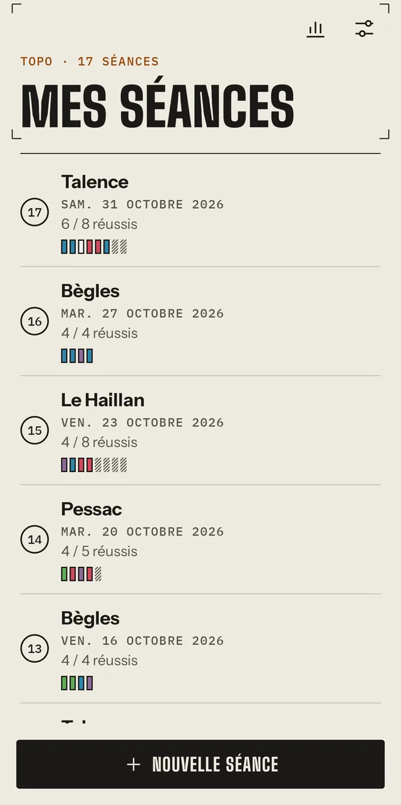
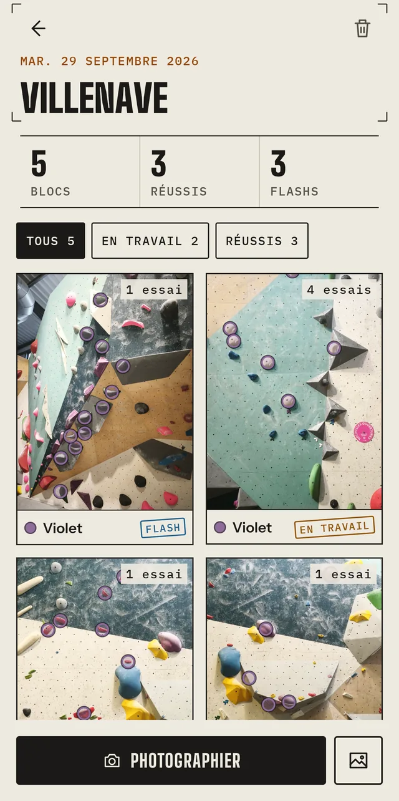
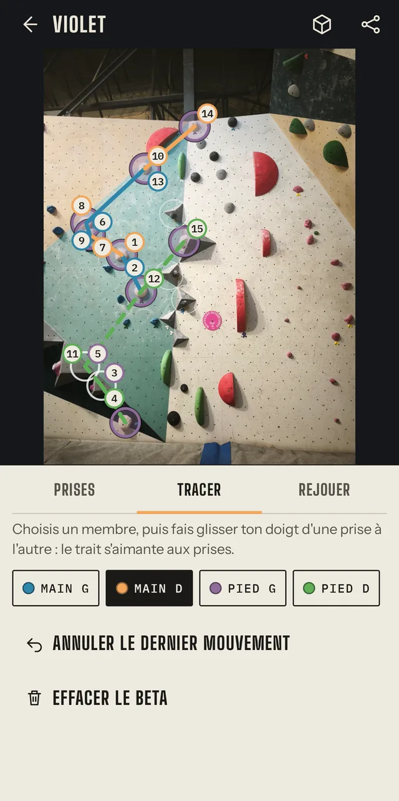
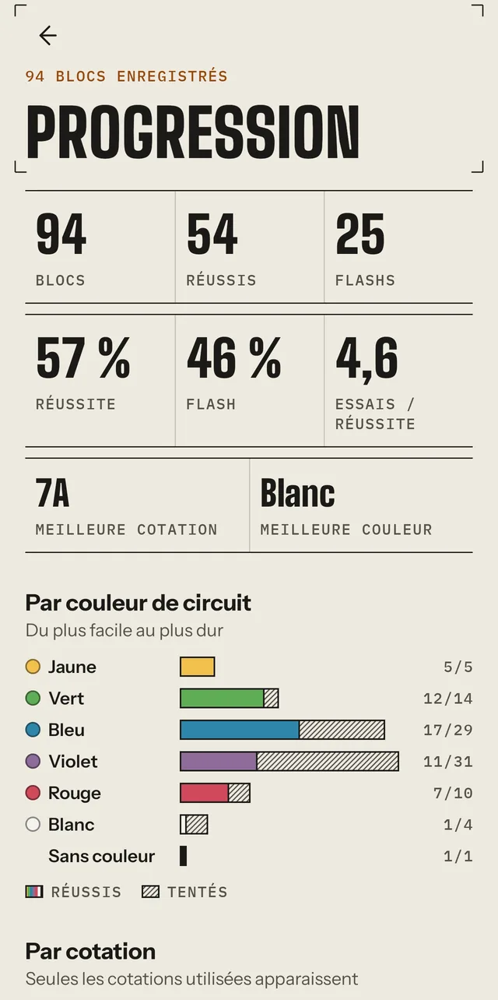

<p align="center">
  
</p>

<h1 align="center">Topo</h1>

<p align="center"><b>Le carnet de bloc qui trace ton beta sur la photo du mur.</b><br>
hors ligne · sans compte ni cloud · tes photos restent dans ton téléphone</p>

<!--
  Captures à produire (design/screenshots/, .webp, largeur 200) :
  <p align="center">
    
    
    
    
  </p>
-->

---

Au pied du mur, on se demande toujours « c'est quoi le topo ? ». Topo te laisse photographier
un bloc, poser ses prises, tracer ton beta au doigt et le rejouer, puis suivre ta progression
séance après séance. Tout reste dans ton téléphone, sans réseau.

## Fonctionnalités

**Au pied du mur**
- Photographie un bloc ou importe une photo de ta galerie, puis cadre-le sur le pan.
- Pose les prises au doigt, ou laisse la détection les proposer en une soixantaine de millisecondes, sans réseau. Un appui retire une prise en trop.
- Garde une couleur : touche une prise de ton bloc et seules les prises de sa couleur restent.
- Trace ton beta en glissant d'une prise à l'autre, main ou pied : le trait s'aimante aux prises et chaque mouvement est numéroté, comme sur un topo.
- Rejoue la séquence mouvement par mouvement, à la vitesse que tu veux.

**Après la séance**
- Note la couleur du circuit et ta cotation, tes essais, ton ressenti et ton statut : projet, en travail, flash, réussi.
- Range le circuit de ta salle dans son ordre, du plus facile au plus dur.
- Suis ta progression : blocs, réussites, flashs, essais par réussite, et barres par couleur et par cotation.
- Partage ton beta en image, ou regarde le bloc en relief 3D.

**Pour tout le monde**
- Papier clair, ardoise de nuit, ou selon ton téléphone : le thème se choisit dans les Réglages.
- Ambiance expressive ou sobre, et respect du réglage Android « Supprimer les animations ».
- Lisible avec TalkBack et en grande police. Les mains se distinguent aussi pour les daltoniens : les pieds sont en pointillés.

## Installer

Télécharge `Topo.apk` depuis la [dernière release](https://github.com/SlashXIV/topo/releases/latest)
et ouvre-le sur ton téléphone (Android 8 ou plus). Les versions suivantes s'installent par-dessus,
sans perdre tes séances.

## Vie privée

- Aucun compte, aucune publicité, aucun traceur.
- Aucune requête réseau : la détection des prises et le relief tournent sur ton téléphone.
- Tes photos sont copiées dans le stockage privé de l'appli. L'import passe par le sélecteur du système : Topo ne voit que la photo choisie, jamais ta galerie.

## Compiler

Prérequis : JDK 17 ou plus (le `jbr` d'Android Studio convient), NDK 28.2 et CMake 3.31.6.

```sh
./gradlew :app:assembleDebug
```

Architecture, preuves techniques (alignement 16 Ko, JNI sans copie, mesures) et matrice de tests :
[`docs/ARCHITECTURE.md`](docs/ARCHITECTURE.md). Le détail des sprints et le journal des décisions :
[`ROADMAP.md`](ROADMAP.md).

## Crédits

- Détection des prises entraînée avec [Ultralytics](https://github.com/ultralytics/ultralytics) (AGPL-3.0), sur des jeux Roboflow sous CC BY 4.0, crédités dans [`ml/README.md`](ml/README.md).
- Relief estimé avec [Depth Anything V2](https://github.com/DepthAnything/Depth-Anything-V2), inférence par [ONNX Runtime](https://onnxruntime.ai).
- Polices sous licence SIL Open Font : Big Shoulders Display, Instrument Sans et IBM Plex Mono ([`design/fonts/`](design/fonts)).

## Licence

[AGPL-3.0](LICENSE). C'est la licence du modèle de détection, entraîné avec Ultralytics et
embarqué dans l'appli.
